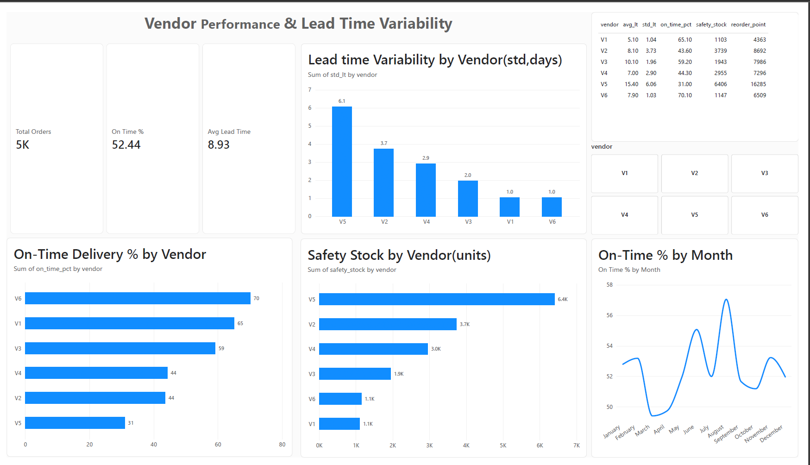

# Vendor Performance & Lead Time Variability Analytics

**Business goal:** Identify unreliable vendors and set safety stock and reorder points so that stockouts are avoided at a 95% service level.

Analysis of vendor delivery reliability and lead time variability,
with safety stock and reorder point calculation per vendor.

## Data
Simulated dataset of 5,000 purchase orders across 6 vendors (2024-2025).
Columns: order_id, vendor, order_date, promised_date, delivery_date, qty, unit_cost.

## Tools
Python (Pandas), MySQL, Power BI

## Method
1. Generated simulated order data in Python
2. Loaded into MySQL, built vendor scorecard with SQL
3. Computed lead time mean, std dev and on-time % in Pandas
4. Safety stock = Z x std(lead time) x daily demand (Z = 1.65, 95% service level)
5. Reorder point = daily demand x avg lead time + safety stock
6. Built Power BI dashboard

## Key findings
- V6 and V1 are the most reliable (70% and 65% on-time, std about 1 day)
- V5 is the riskiest: 31% on-time, std 6.06 days
- V5 needs about 6,400 units of safety stock vs about 1,150 for V6
- Recommendation: shift orders from V5 to V6/V1, or hold higher buffer stock for V5

## Limitation
Demand is assumed constant, and data is simulated.

## Files
- vendor_performance.ipynb: data generation and Pandas analysis
- queries.sql: MySQL table and vendor scorecard queries
- orders.csv: simulated dataset (5,000 orders)
- vendor_summary.csv: per-vendor results
- vendor_dashboard.pbix: Power BI dashboard
